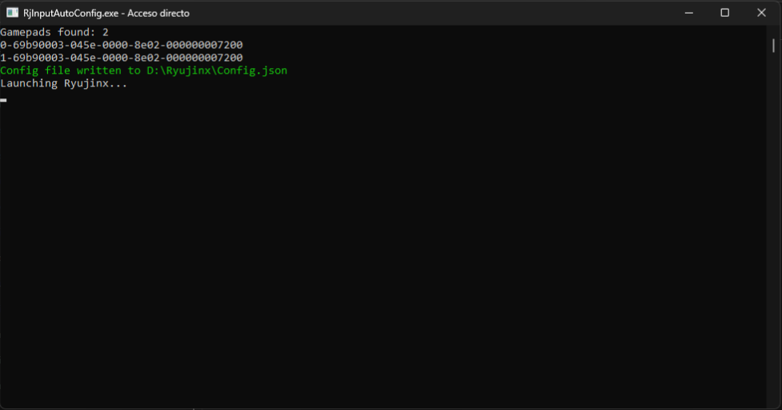

# Ryujinx Input Auto Config

Utility to automatically configure input in Ryujinx emulator. It detects connected gamepads and configures Ryujinx.  
  
*This application is not affiliated with Ryujinx emulator.*


## Features
- Gamepads auto detection
- Customizable input settings to configure
- Ryujinx launch after configuration
- Integration with [Playnite](https://playnite.link/) (or other launchers)
- Works with [Moonlight](https://moonlight-stream.org/), [Steam Link](https://store.steampowered.com/remoteplay) or other streaming clients.


## Installation
It is a portable app. Simply extract/place files in a folder.


## Configuration
### App settings
To configure the app, edit the "**appsettings.json**" file and set the paths to your files.  
- *RyujinxConfigFilepath* is required. Path to Ryujinx "Config.json" file (default path is "%USERPROFILE%\AppData\Roaming\Ryujinx\config.json").
- *RyujinxProgramFilepath* is optional. Path to Ryujinx executable file (default path is "%USERPROFILE%\AppData\Roaming\Ryujinx\ryujinx.exe"). Leave empty ("") or remove setting to avoid launching Ryujinx. Parameters sent to "RjInputAutoConfig.exe" will be sent to "ryujinx.exe".

Use a double backslash "\\\\" for path separators.  
Relative paths and environment variables are allowed.  

Configuration examples:
```json
{
    "RyujinxConfigFilepath": "..\\Ryujinx\\config.json",
    "RyujinxProgramFilepath": "..\\Ryujinx\\ryujinx.exe"
}
```
```json
{
    "RyujinxConfigFilepath": "%USERPROFILE%\\AppData\\Roaming\\Ryujinx\\config.json",
    "RyujinxProgramFilepath": "%USERPROFILE%\\AppData\\Roaming\\Ryujinx\\ryujinx.exe"
}
```
```json
{
    "RyujinxConfigFilepath": "C:\\Users\\myuser\\AppData\\Roaming\\Ryujinx\\config.json",
    "RyujinxProgramFilepath": "C:\\Users\\myuser\\AppData\\Roaming\\Ryujinx\\ryujinx.exe"
}
```

### Input settings
To configure the input settings, edit the "**ryujinxgamepadinput.json**" file to define your input configuration. If you don't know how to use it, configure input from Ryujinx user interface and copy the values from Ryujinx "Config.json" file to "ryujinxgamepadinput.json".


## Run
To run the app execute "RjInputAutoConfig.exe".

## Integration with [Playnite](https://playnite.link/)  (or other launchers) 
- Rename "RjInputAutoConfig.exe" to "Ryujinx.exe".
- Set "RyujinxProgramFilepath" in appsettings.json (relative paths and environment variables are allowed):
- Configure Playnite to use the renamed .exe (parameters sent by Playnite will be sent to Ryujinx).  

*This application is not affiliated with [Playnite](https://playnite.link/).*

## Screenshot
